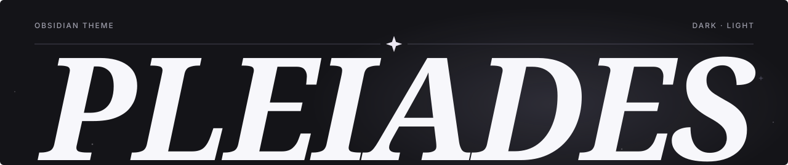
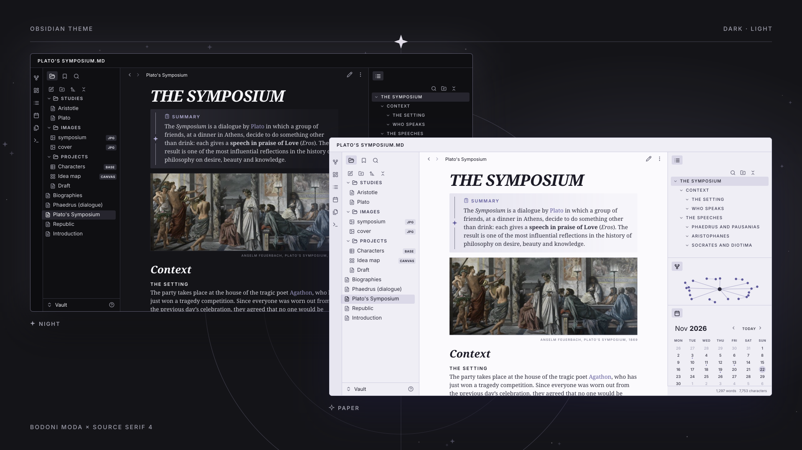
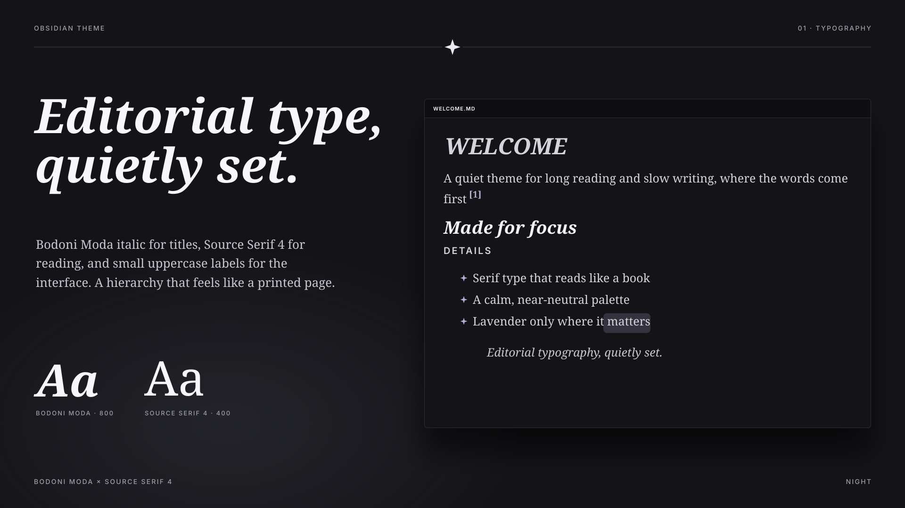
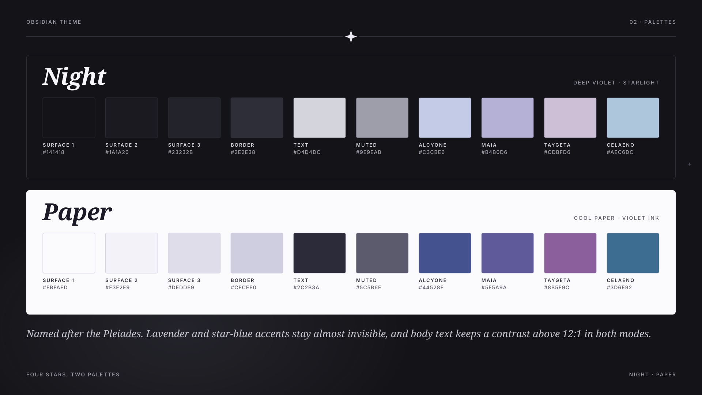
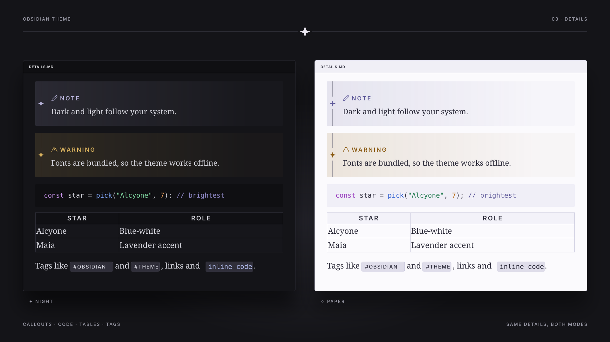
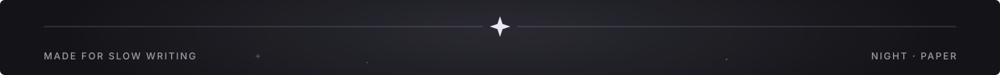

[Português](/README.pt.md) · English

## 📑 Contents
- [📑 Contents](#-contents)
- [📃 Preface](#-preface)
- [✨ Features](#-features)
- [📥 Installation](#-installation)
- [🔍 In detail](#-in-detail)
  - [🔤 Typography](#-typography)
  - [🎨 Palettes](#-palettes)
  - [✦ Callouts, code, tables and tags](#-callouts-code-tables-and-tags)
- [🧩 Compatibility](#-compatibility)
- [☕ If you like the theme](#-if-you-like-the-theme)
- [📬 Feedback and support](#-feedback-and-support)
- [📄 Credits and license](#-credits-and-license)

## 📃 Preface

I made this theme for my own use. It may not suit everyone, and that's fine. It was built with AI tools, which I used to learn along the way. If it works for you too, I'm glad.

Pleiades doesn't reinvent Obsidian: it just makes reading and writing calmer. It takes care of four things:

- Editorial typography, with a book-like serif.
- Near-neutral surfaces, with barely-there lavender.
- Two modes, **Night** (dark) and **Paper** (light), following the app or the system.
- The four-pointed star (✦) as the only ornament.

## ✨ Features

- **Editorial typography**: Bodoni Moda italic for headings, Source Serif 4 for reading, and small uppercase labels in the interface. A hierarchy that feels like a printed page.
- **Calm palette**: near-neutral surfaces with barely-there lavender and star blue. Body text keeps contrast above 12:1 in both modes.
- **Dark and light**: **Night** and **Paper** follow the app or system appearance.
- **Careful details**: callouts, code blocks, tables, tags and inline code share the same finish in both modes.
- **Star as ornament**: list bullets, heading separator and callouts use ✦.
- **Embedded fonts**: Bodoni Moda and Source Serif 4 ship inside the theme, which works offline.

## 📥 Installation

1. Download `theme.css` and `manifest.json` from this repository.
2. In your vault, create the folder `.obsidian/themes/Pleiades/` and put both files in it.
3. In Obsidian, open **Settings → Appearance → Themes** and select **Pleiades**.

> [!NOTE]
> To switch between Night and Paper, change the app appearance to dark or light (or let it follow the system). There is no other switch: the theme has no settings of its own.

## 🔍 In detail

### 🔤 Typography

| Use                | Font                                       |
|--------------------|--------------------------------------------|
| Note title and H1  | Bodoni Moda, italic, 800, uppercase        |
| H2                 | Bodoni Moda, italic, 600                   |
| H3 to H6           | Obsidian's interface font, uppercase, 600  |
| Reading            | Source Serif 4, 400 (bold 600, italic 400) |
| Labels & interface | Obsidian's interface font, uppercase       |

### 🎨 Palettes

Named after the stars of the Pleiades.

**Night: deep violet · starlight**

| Token     | Color     |
|-----------|-----------|
| Surface 1 | `#141418` |
| Surface 2 | `#1A1A20` |
| Surface 3 | `#23232B` |
| Border    | `#2E2E38` |
| Text      | `#D4D4DC` |
| Muted     | `#9E9EAB` |
| Alcyone   | `#C3CBE6` |
| Maia      | `#B4B0D6` |
| Taygeta   | `#CDBFD6` |
| Celaeno   | `#AEC6DC` |

**Paper: cool paper · violet ink**

| Token     | Color     |
|-----------|-----------|
| Surface 1 | `#FBFAFD` |
| Surface 2 | `#F3F2F9` |
| Surface 3 | `#DEDDE9` |
| Border    | `#CFCEE0` |
| Text      | `#2C2B3A` |
| Muted     | `#5C5B6E` |
| Alcyone   | `#44528F` |
| Maia      | `#5F5A9A` |
| Taygeta   | `#8B5F9C` |
| Celaeno   | `#3D6E92` |

### ✦ Callouts, code, tables and tags

The same finish in both modes: callouts with a side line and a star, code blocks, tables, tags and inline code.

## 🧩 Compatibility

- Obsidian **1.0.0** or newer.
- No plugins required, not even Style Settings.
- Covers callouts, code, tables and Bases, tags, checkboxes, file explorer, tabs, buttons and scrollbar, in both modes.

## ☕ If you like the theme

Leave a ⭐ on the repository and tell anyone who might enjoy it. It helps more than it seems.

It's free and also serves as my way of learning. If you'd like to chip in with a coffee (or save my back and my sleepless nights), the link is here:

## 📬 Feedback and support

Found a bug or have a suggestion? Open an issue on the repository. For visual problems, a screenshot and whether you were in Night or Paper helps a lot.

## 📄 Credits and license

- Version `1.0.0`.
- License: [set the project's license, for example MIT, and add a `LICENSE` file].
- Bundled fonts, under the OFL: [Bodoni Moda](https://fonts.google.com/specimen/Bodoni+Moda) and [Source Serif 4](https://fonts.google.com/specimen/Source+Serif+4).

