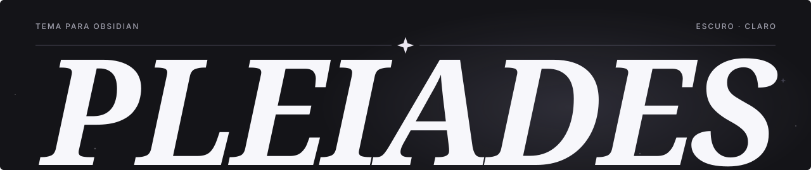
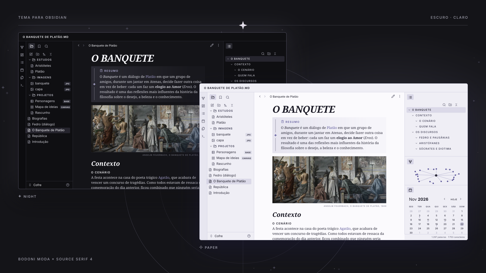
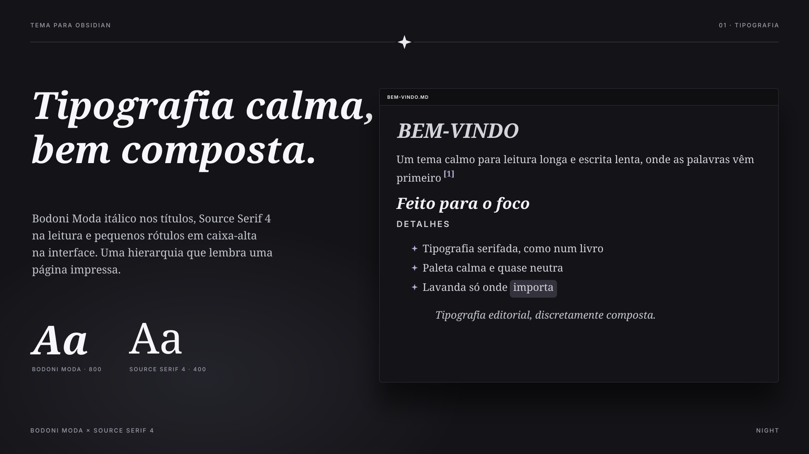
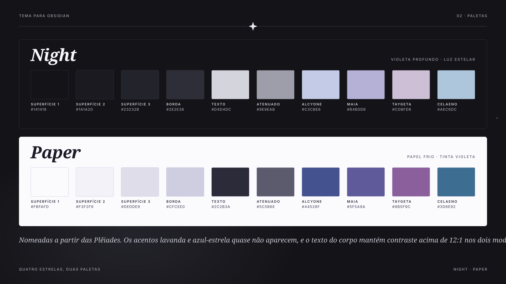
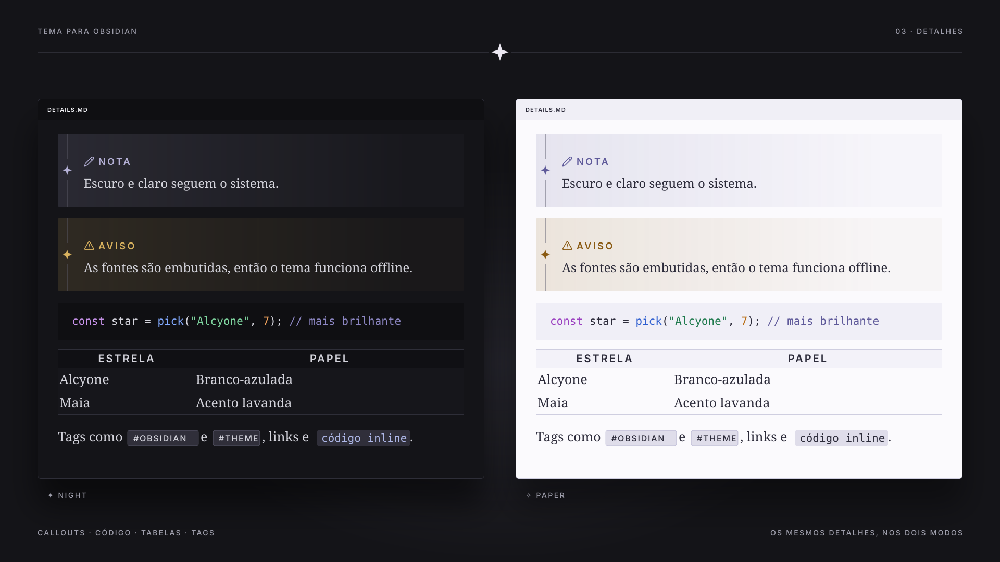
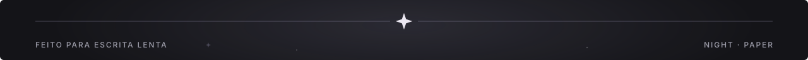

Português · [English](./README.md)

## 📑 Conteúdo

- [📑 Conteúdo](#-conteúdo)
- [📃 Prefácio](#-prefácio)
- [✨ Características](#-características)
- [📥 Instalação](#-instalação)
- [🔍 Em detalhe](#-em-detalhe)
  - [🔤 Tipografia](#-tipografia)
  - [🎨 Paletas](#-paletas)
  - [⭐ Callouts, código, tabelas e tags](#callouts-código-tabelas-e-tags)
- [🧩 Compatibilidade](#-compatibilidade)
- [☕ Se você gostar do tema](#-se-você-gostar-do-tema)
- [📬 Feedback e suporte](#-feedback-e-suporte)
- [📄 Créditos e licença](#-créditos-e-licença)

## 📃 Prefácio

Fiz este tema para o meu próprio uso. Ele pode não atender a todo mundo, e tudo bem. Foi desenvolvido com ferramentas de IA, que usei para aprender enquanto construía. Se ele funcionar para você também, fico feliz.

O Pleiades não reinventa o Obsidian: ele só deixa a leitura e a escrita mais calmas. Cuida de quatro coisas:

- Tipografia editorial, com serifa de livro.
- Superfícies quase neutras, com lavanda quase invisível.
- Dois modos, **Night** (escuro) e **Paper** (claro), que seguem o app ou o sistema.
- A estrela de quatro pontas (✦) como único ornamento.

## ✨ Características

- **Tipografia editorial**: Bodoni Moda itálico nos títulos, Source Serif 4 na leitura e pequenos rótulos em caixa-alta na interface. Uma hierarquia que lembra uma página impressa.
- **Paleta calma**: superfícies quase neutras, com lavanda e azul-estrela quase invisíveis. O texto do corpo mantém contraste acima de 12:1 nos dois modos.
- **Escuro e claro**: **Night** e **Paper** seguem a aparência do app ou do sistema.
- **Detalhes cuidados**: callouts, blocos de código, tabelas, tags e código inline com o mesmo acabamento nos dois modos.
- **Estrela como ornamento**: marcadores de lista, separador de título e callouts usam ✦.
- **Fontes embutidas**: Bodoni Moda e Source Serif 4 vão dentro do tema, que funciona offline.

## 📥 Instalação

1. Baixe `theme.css` e `manifest.json` deste repositório.
2. No seu cofre, crie a pasta `.obsidian/themes/Pleiades/` e coloque os dois arquivos dentro dela.
3. No Obsidian, abra **Configurações → Aparência → Temas** e selecione **Pleiades**.

> [!NOTE]
> Para alternar entre Night e Paper, mude a aparência do app para escuro ou claro (ou deixe seguir o sistema). Não há outro botão: o tema não tem configurações próprias.

## 🔍 Em detalhe

### 🔤 Tipografia

| Uso                 | Fonte                                           |
|---------------------|-------------------------------------------------|
| Título da nota e H1 | Bodoni Moda, itálico, 800, caixa-alta           |
| H2                  | Bodoni Moda, itálico, 600                       |
| H3 a H6             | Fonte da interface do Obsidian, caixa-alta, 600 |
| Leitura             | Source Serif 4, 400 (negrito 600, itálico 400)  |
| Rótulos e interface | Fonte da interface do Obsidian, caixa-alta      |

### 🎨 Paletas

Nomeadas a partir das estrelas das Plêiades.

**Night: violeta profundo · luz estelar**

| Token     | Cor       |
|-----------|-----------|
| Surface 1 | `#141418` |
| Surface 2 | `#1A1A20` |
| Surface 3 | `#23232B` |
| Border    | `#2E2E38` |
| Text      | `#D4D4DC` |
| Muted     | `#9E9EAB` |
| Alcyone   | `#C3CBE6` |
| Maia      | `#B4B0D6` |
| Taygeta   | `#CDBFD6` |
| Celaeno   | `#AEC6DC` |

**Paper: papel frio · tinta violeta**

| Token     | Cor       |
|-----------|-----------|
| Surface 1 | `#FBFAFD` |
| Surface 2 | `#F3F2F9` |
| Surface 3 | `#DEDDE9` |
| Border    | `#CFCEE0` |
| Text      | `#2C2B3A` |
| Muted     | `#5C5B6E` |
| Alcyone   | `#44528F` |
| Maia      | `#5F5A9A` |
| Taygeta   | `#8B5F9C` |
| Celaeno   | `#3D6E92` |

### ⭐ Callouts, código, tabelas e tags

Os mesmos acabamentos nos dois modos: callouts com fio lateral e estrela, blocos de código, tabelas, tags e código inline.

## 🧩 Compatibilidade

- Obsidian **1.0.0** ou mais recente.
- Não depende de plugins, nem do Style Settings.
- Cobre callouts, código, tabelas e Bases, tags, checkboxes, explorador de arquivos, abas, botões e scrollbar, nos dois modos.

## ☕ Se você gostar do tema

Considere contribuir com um cafezinho, o tema é gratuito mas sua contribuição já me ajuda muito.

Deixe uma ⭐ no repositório e conte a quem possa se interessar. Isso ajuda mais do que parece.

## 📬 Feedback e suporte

Encontrou um erro ou tem uma sugestão? Abra uma *issue* no repositório. Se for um problema visual, ajuda muito incluir uma captura de tela e dizer se estava em Night ou Paper.

## 📄 Créditos e licença

- Versão `1.0.0`.
- Licença: [defina a do projeto, por exemplo MIT, e adicione um arquivo `LICENSE`].
- Fontes embutidas, sob a licença OFL: [Bodoni Moda](https://fonts.google.com/specimen/Bodoni+Moda) e [Source Serif 4](https://fonts.google.com/specimen/Source+Serif+4).

